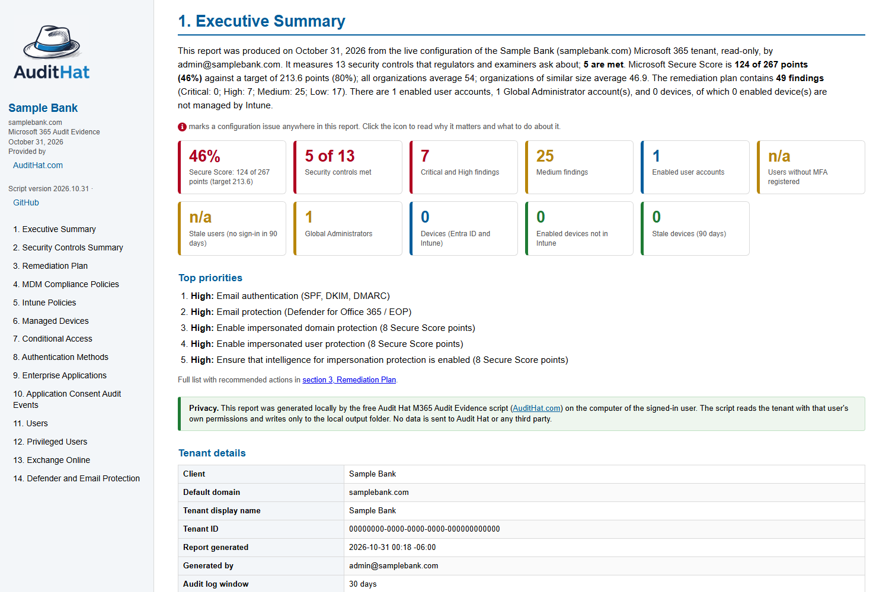
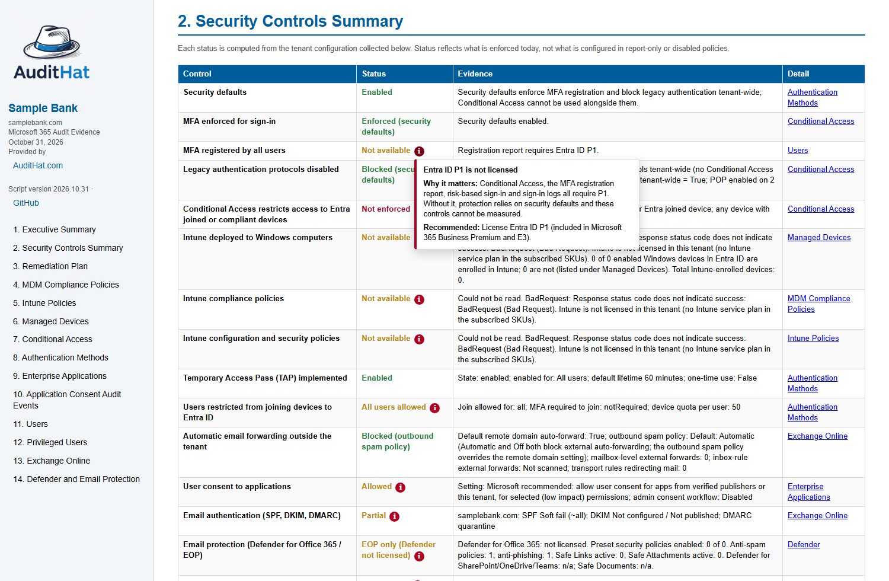
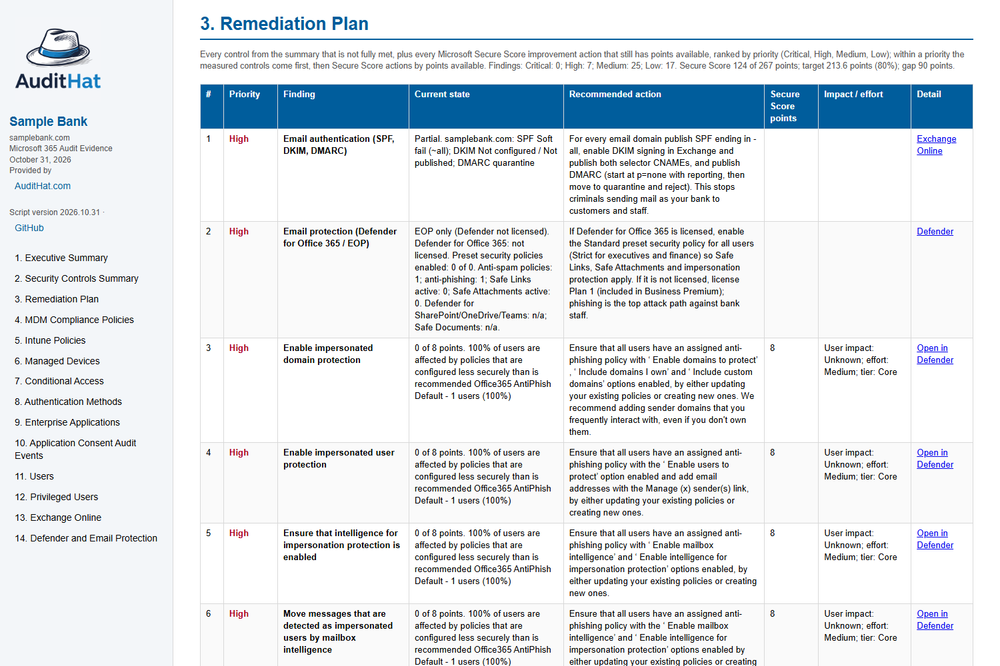
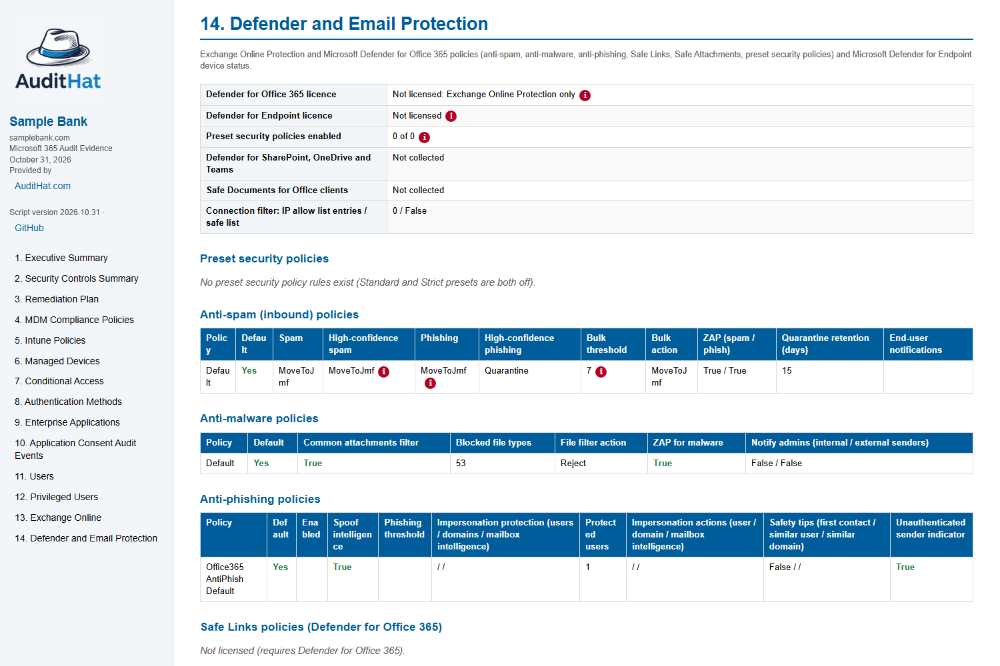
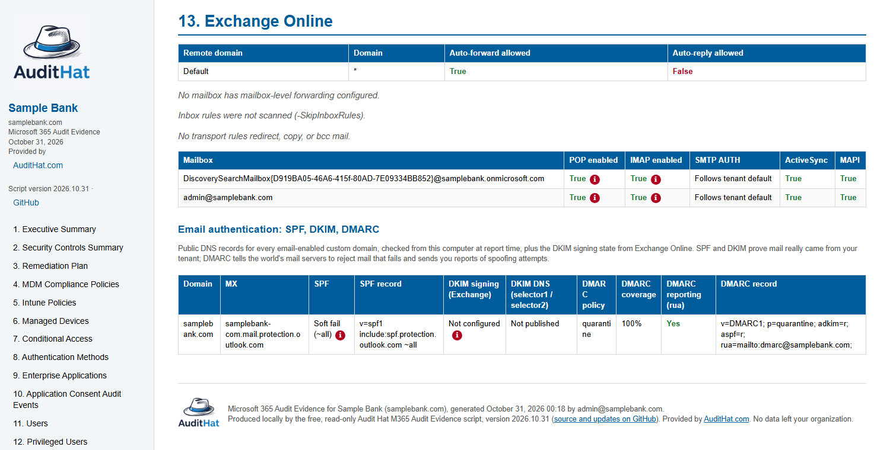
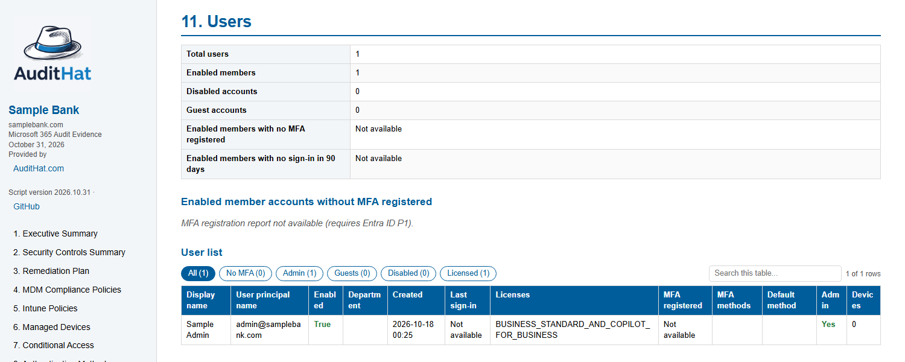

# AuditHat M365 Audit Evidence

**Version:** 2026.11.04 (date-based) · **Source:** https://github.com/ryanerb4/AuditHat-M365-Audit-Evidence

**Author:** Ryan Erb · **Provided by:** [Audit Hat](https://AuditHat.com)

**Built for banks and credit unions.** This script is designed to help financial institutions
understand their Microsoft 365 security posture and risk, maintain it over time, and give the IT
steering committee, the board, examiners and auditors the information they need, in plain language,
from one read-only run.

One read-only PowerShell script signs in to Microsoft 365 with your own admin account, collects the
Entra ID, Intune, Conditional Access, application, user, privileged-role, Exchange Online, Defender,
Teams and SharePoint/OneDrive evidence an IT auditor or examiner asks for, and writes a single
self-contained HTML report: an executive summary with KPI tiles, a **remediation roadmap** (this week,
30 days, 90 days, the year) in which every finding carries step-by-step instructions, an owner, an
effort estimate and a "done when" test and copies straight into a ticket for your IT provider, a
**Possible Indications of Compromise** section (what to research today), a **Framework Alignment**
section mapping every control to NIST CSF 2.0, NIST SP 800-63B, the CIS Microsoft 365 Benchmark, CIS
Controls v8 and FFIEC / NCUA expectations, the **MFA product in use and the passkey rollout**,
Microsoft Secure Score against a target, and the detailed evidence behind every number, with a
clickable **i** icon on each configuration issue explaining why it matters and how to fix it. The
report opens in your browser when the run finishes. Optionally it also produces two Word
documents (`MDM Configuration.docx`, `Conditional Access Policies.docx`).

## Operating model: who runs it, how often, who reads what

The goal is a repeatable, evidence-based cycle that a community bank or credit union can sustain with
its existing staff and IT provider, and that auditors and examiners recognise as a working program.

| Cadence | Who | What happens |
|---|---|---|
| **Monthly** | Security officer or IT provider / MSP | Run the script (10 to 30 minutes). Work section 2 (review these now: indications of compromise) the same day. Turn the Remediation Plan into tickets (Copy ticket / CSV) and assign owners. File the report in the evidence folder; the history file updates itself |
| **Monthly, next run** | Same | "Progress since last report" shows what closed, what regressed and what is new. Chase open tickets |
| **Quarterly** | IT steering committee | Review the Executive Summary, the Roadmap and the Governance table; approve phases, owners, licences and budget; record decisions in minutes. Record the review in the minutes |
| **At least annually, and after any incident** | Board (or its risk / audit committee) | Receive At a Glance, the Executive Action Plan and the Executive Summary (narrative, tiles, trend charts, progress). Record it in the board minutes |
| **Before and during an exam or audit** | Auditor / examiner | Section 3 as the control test, section 5 for the framework mapping, the history for the trend, sections 6 to 19 as evidence. The minutes show governance |

Keep every monthly report. Together with the history file they are the evidence that controls are
measured the same way each month, that gaps are planned and worked, and that the board is informed:
the three things examiners ask for under FFIEC, NCUA and GLBA Safeguards expectations.

Who it is for:

- **Board members:** the first page, **At a Glance**, shows each area (sign-in, administrators, device
  management, endpoint protection, email, sharing, logging, Secure Score) in green, amber or red;
  a click lists the controls behind the colour. The next page, the **Executive Action Plan**,
  turns those areas into business goals with a target date and a milestone timeline the board can
  hold management to. The opening paragraph, the tiles and the trend
  charts that follow answer "are we secure, are we improving, is there a plan" without any
  Microsoft 365 knowledge.
- **IT committee members:** the Roadmap lays the plan out by phase with owners and effort, and the
  Governance table shows cadence, progress and the next review date, so the committee can decide
  and record decisions.
- **Security officers and IT providers / MSPs:** every finding has step-by-step instructions, a
  prerequisite, a "done when" test and a Copy ticket button; the indications-of-compromise section
  tells them what to look at today.
- **Auditors:** section 3 is the control test, section 5 maps every control to NIST, CIS and FFIEC /
  NCUA so recommendations can cite the standard, and the evidence sections back every status.
- **Examiners:** the monthly history, the progress section and the committee minutes demonstrate that
  the institution measures, reviews, plans and improves, with evidence pulled live from the tenant,
  dated and attributed, nothing retyped from portals.

Run it monthly and keep the reports: the same controls measured the same way give the committee a
trend and the auditor a history. The script keeps a small history file per
tenant next to the reports (headline figures and control statuses only, no names) and uses it to
show **Progress since last report** in the Executive Summary: a change log of every control,
finding and headline count that moved, plus two trend charts (Secure Score against target, and open
findings by priority) across all kept runs. The **Executive Action Plan** uses the same file to fix
each finding's due date from the first report that listed it, so a late item shows as overdue instead
of moving out again every month, and to show the last 12 months month by month: findings closed,
goals reached or slipped back, controls in place and Secure Score. Run every month into the same
output folder, without `-NoHistory`; if the history file is lost, the look-back and the due dates
start again from that run. See `CHANGELOG.md` for the script's own version history.

**Companion project for on-premises Active Directory:**
[AuditHat AD Governance Report](https://github.com/ryanerb4/audithat-ad-governance-report) does the
same job for the on-premises directory (accounts, groups, privileged access, password policy, stale
objects). Institutions that synchronise AD to Microsoft 365 should run both; this report shows the
Entra Connect sync status and links to the companion from the overview and the footer.

## Navigating the report

The report opens as a set of pages, starting with **At a Glance**: the left navigation shows one
section at a time, with Previous and Next buttons and a "Section n of 21" marker in a toolbar that
stays at the top; the section heading
stays pinned under it while you scroll. Every link inside the report (a finding
in the roadmap, "Progress since last report", a situation-table detail) opens the right page and
scrolls to the item. **Show all sections** switches to the whole report on one long page for
scrolling or searching with Ctrl+F; every report opens in the paged view. Printing always
prints the whole report, with the step-by-step lists expanded.

## What the report looks like

Screenshots from a sample run (tenant names replaced). Click any image to view it full size.

| | |
|---|---|
| [](docs/screenshots/executive-summary.png) **Executive Summary**: narrative, KPI tiles, top priorities, privacy statement, tenant details | [](docs/screenshots/security-controls-summary.png) **Security Controls Summary** with an info panel open on a flagged control |
| [](docs/screenshots/remediation-plan.png) **Remediation Plan**: every gap ranked Critical to Low with the recommended action and Secure Score points | [](docs/screenshots/defender-email-protection.png) **Defender and Email Protection**: licences, presets, anti-spam, anti-malware, anti-phishing, Safe Links and Safe Attachments |
| [](docs/screenshots/email-authentication.png) **Exchange Online**: forwarding, POP/IMAP/SMTP AUTH, and SPF / DKIM / DMARC per domain | [](docs/screenshots/users.png) **Users**: counts, quick filters (Stale, No MFA, Admin, Guests, Disabled, Licensed), search, devices per user |

## Privacy: your data never leaves your organization

**This script sends no data to Audit Hat or to any third party.** It is a free, purely internal tool
provided for your own use to help you understand and reduce your Microsoft 365 risk.

- It runs entirely on the computer where you start it. Nothing is stored between runs unless you ask
  for `-SaveSignIn`, which keeps an encrypted refresh token for the Windows user on that PC (see
  "Running on a schedule").
- It reads your tenant with the account **you** sign in with, read-only, and writes the report only
  to the output folder on that computer (default `.\M365-Audit-Evidence`).
- Audit Hat has no server side for this tool and receives nothing: no telemetry, no copies, no
  "phone home". You can confirm this by reading the script; every network call goes to Microsoft
  (`login.microsoftonline.com`, `graph.microsoft.com`, `outlook.office365.com`,
  `powershellgallery.com` for module install).

**Why there is an "AuditHat" app in the sign-in.** Microsoft requires every sign-in to identify an
application. The script identifies itself as the **AuditHat Pulse Reports (PowerShell)** connector,
an Entra enterprise application published by Audit Hat (the "Microsoft 365 AuditHat PowerShell
connector"). Consenting to it in your tenant **grants this local script read-only rights for the
signed-in user and nothing else**:

- it holds no client secret or certificate, so nobody can use it without a person signing in with
  your tenant's own MFA;
- it has delegated permissions only, so it can never do more than the signed-in person can;
- it has no application (unattended) permissions and no server behind it.

If your policy requires a tenant-owned app instead, see "Register your own app" below and pass
`-ClientId`; the script behaves identically.

---

## Quick start

```powershell
# 1. Allow scripts for this PowerShell window only
Set-ExecutionPolicy -Scope Process -ExecutionPolicy Bypass

# 2. Run it (modules install themselves on first run; a browser window opens for sign-in).
#    The report is named after the tenant display name and default domain; -ClientName overrides that.
.\Get-M365AuditEvidence.ps1

# With the two Word documents (needs Microsoft Word on this PC)
.\Get-M365AuditEvidence.ps1 -ClientName "Sample Bank" -WordDocs

# Tenant blocks the AuditHat connector app (AADSTS700016)? Use your own app registration (see below)
.\Get-M365AuditEvidence.ps1 -ClientName "Sample Bank" -ClientId <app id> -TenantId <tenant id>

# Check permissions, licences and modules first (signs in, probes every API the report uses, prints what is missing, writes nothing)
.\Get-M365AuditEvidence.ps1 -TestPermissions

# Target a specific tenant and output folder, skip the slow inbox-rule scan
.\Get-M365AuditEvidence.ps1 -TenantId contoso.onmicrosoft.com -OutputFolder C:\Audit\Contoso -SkipInboxRules

# Another organization (consultant or MSP): always name its tenant. See "Auditing more than one organization"
.\Get-M365AuditEvidence.ps1 -TenantId secondbank.com
```

Output lands in `.\M365-Audit-Evidence\<Client> - M365 Audit Evidence <date>.html` by default, next to
`<Client> - Remediation tickets <date>.csv` and the per-tenant history file. The report opens in
your default browser when the run completes (`-NoOpen` suppresses that).

**Run logs.** Every run also writes two text files next to the report, named with the run's start
time: `<Client> - Run log <yyyy-MM-dd HHmmss>.log` holds everything shown in the console, and
`<Client> - Errors <yyyy-MM-dd HHmmss>.log` lists the warnings shown, the full text of messages from
Microsoft's modules, and every error recorded during the run with a count. Send the errors log when
asking for help. They contain account and mailbox names, so keep them with the report. `-NoLog`
turns them off.

**Progress while it runs.** Each step prints `[n/N] step (run time)` and how long it took, with an
overall progress bar. Long downloads (the sign-in log, directory audit events, large lists) show a
second bar with records read, how far back in the window the log has been read, a percentage and
the time left, and leave a line in the run log every ten pages. The unified audit log search shows
records and pages read. The run ends with the total time.

**Log cache.** Sign-ins and directory audit events already downloaded are kept, compressed, in
`<output folder>\cache\<tenant id>\`. The next run downloads only what is new since the last run
(plus a 24-hour overlap, because Microsoft records some events late) and drops events older than the
window. A rerun the same day, or weekly runs, mostly read from the cache; a monthly run with the
default 30-day window still downloads most of the month, because Microsoft keeps sign-ins for only
30 days. The sign-in log is downloaded once and split into successes and failures on this computer
(earlier versions sent one filtered query per failure type, which Microsoft serves slowly). The
cache holds user names and IP addresses, stays on this computer like the reports, and is never
uploaded; delete the folder at any time, or use `-NoCache` to turn it off.

**You sign in once.** The browser sign-in is reused for Exchange Online (and, when the module is
installed, Teams) through the same connector, so there is no second prompt. If the connector has
not been granted the Exchange permission in your tenant yet, the script warns and falls back to a
separate Exchange sign-in; a Global Administrator fixes that once with the admin-consent link the
script prints.

---

## Running on a schedule (saved sign-in)

By default every run opens the browser for an MFA sign-in. For a monthly scheduled run, save the
sign-in once and let the task reuse it:

```powershell
# 1. Once, interactively, as the Windows user that will run the task: sign in and save it
.\Get-M365AuditEvidence.ps1 -SaveSignIn

# 2. Later runs (and the task) sign in silently. -NonInteractive never prompts; it stops with exit code 2 if the saved sign-in no longer works.
.\Get-M365AuditEvidence.ps1 -NonInteractive -NoOpen -SkipInboxRules

# 3. Windows Task Scheduler, first day of every month at 06:00, as the same Windows user
schtasks /Create /TN "AuditHat M365 Audit Evidence" /SC MONTHLY /D 1 /ST 06:00 /RL LIMITED ^
  /TR "pwsh -NoProfile -ExecutionPolicy Bypass -File C:\Audit\Get-M365AuditEvidence.ps1 -NonInteractive -NoOpen -OutputFolder C:\Audit\Reports"

# Remove the saved sign-in
.\Get-M365AuditEvidence.ps1 -ForgetSignIn

# More than one organization: name the tenant every time. Each tenant gets its own saved sign-in and history.
.\Get-M365AuditEvidence.ps1 -TenantId secondbank.com -SaveSignIn
.\Get-M365AuditEvidence.ps1 -TenantId secondbank.com -NonInteractive -NoOpen
```

Without `-TenantId` the script uses the one default saved sign-in, which belongs to whichever
organization was saved first. When you audit several organizations from one PC, always pass
`-TenantId` so each run signs in to the right one (see "Auditing more than one organization").

What is saved and how it is protected:

- Only the OAuth **refresh token** from the browser sign-in is kept, encrypted with Windows Data
  Protection (DPAPI) for the current Windows user on the current computer, at
  `%LOCALAPPDATA%\AuditHat\M365AuditEvidence.signin`. Another user or another PC cannot decrypt it.
  No password is ever stored.
- Anyone who can run code as that Windows user can use the token, so treat the account the way you
  treat a service account: a dedicated **Global Reader** (plus View-Only Organization Management in
  Exchange) with its own strong MFA, on a managed PC. Do not save a Global Administrator sign-in.
- The token keeps working as long as it is used at least every 90 days and the account is not
  changed. A password change, "revoke sessions", disabling the account or a Conditional Access
  sign-in-frequency policy invalidates it; the next run then says so and, unless `-NonInteractive`,
  falls back to the browser. Grant new permissions by running once with `-ForgetSignIn -SaveSignIn`.
- The same saved sign-in also feeds the Exchange Online, Defender for Endpoint and Teams tokens, so a
  scheduled run collects everything the interactive run does. Device-code sign-ins cannot be saved.
- The script remains delegated and read-only: it acts only as that user, with that user's roles.
  There is no application-only (certificate) mode by design, so there is never a credential that
  works without a person having signed in with MFA.

On Linux or macOS there is no DPAPI, so saved sign-ins are Windows-only; the script itself targets
Windows PowerShell 5.1 and PowerShell 7 on Windows.

---

## Auditing more than one organization

Consultants, IT providers and MSPs can run the same script for several banks or credit unions from
one PC. Each organization is handled separately: its own sign-in, its own consent, its own reports
and its own history.

1. **Approve the connector once in the new organization.** A Global Administrator of that
   organization either runs the script the first time, or opens this link ahead of time and accepts
   the read-only permissions (replace the domain with theirs):

   ```
   https://login.microsoftonline.com/secondbank.com/adminconsent?client_id=ae173bf3-ba47-4ab8-ac54-3ea92fa6c337
   ```

   If their policy does not allow third-party enterprise applications, register an app in their
   tenant instead (see "Register your own app") and pass its `-ClientId` on every run for them.

   That one approval covers Microsoft Graph, Exchange Online, Defender for Endpoint and Teams
   together. Organizations that approved an older version of the script may have approved Graph
   only. The run then says which service is not approved (Exchange asks for its own sign-in instead
   of failing) and, at the end, prints the approval link under "One-time approval needed in this
   tenant". A Global Administrator opens it once and clicks Accept; the per-service links that
   follow it end on a localhost page that does not load, which is expected.
2. **Sign in with an account in that organization.** Use a Global Reader there, plus View-Only
   Organization Management in Exchange (see "Which account to sign in with"). Use a member account
   of their tenant: guest accounts and partner (GDAP) access are not tested and Exchange Online
   PowerShell does not accept guest administrators.
3. **Name the tenant on every run** with `-TenantId` (their domain, such as `secondbank.com`, or
   their tenant ID). This sends the sign-in to the right organization and keeps a separate saved
   sign-in for each one.

   ```powershell
   # First run for the organization: browser sign-in, then save it for later runs
   .\Get-M365AuditEvidence.ps1 -TenantId secondbank.com -SaveSignIn -OutputFolder C:\Audit\SecondBank

   # Later runs, or a scheduled task: silent sign-in for that organization only
   .\Get-M365AuditEvidence.ps1 -TenantId secondbank.com -NonInteractive -NoOpen -OutputFolder C:\Audit\SecondBank
   ```

4. **Check the first report.** The Executive Summary and the tenant details name the organization
   and the signed-in account, so you can confirm the right tenant was read.

What stays separate:

- **Saved sign-in:** `%LOCALAPPDATA%\AuditHat\M365AuditEvidence-<tenant>.signin`, one file per
  `-TenantId`. Without `-TenantId` the script uses the default saved sign-in, which belongs to
  whichever organization was saved first, so it would read that organization again.
- **Reports, ticket CSV and history** are named after the organization's display name. A separate
  `-OutputFolder` per organization keeps the files apart and makes the evidence folder easy to
  hand over.
- **Settings file:** `M365AuditEvidence.settings.json` next to the script applies to every run from
  that folder. Values on the command line win over it, so `-TenantId` always picks the
  organization. Do not save one organization's own `ClientId` there if you also audit others with
  the AuditHat connector. Use a separate copy of the script folder per organization instead.

Nothing from one organization is ever sent to another, or to Audit Hat.

## Requirements

| # | Requirement | Notes |
|---|-------------|-------|
| 1 | Windows 10/11 or Windows Server | Windows PowerShell 5.1 (built in) or PowerShell 7.x |
| 2 | Internet access | graph.microsoft.com, login.microsoftonline.com, outlook.office365.com, powershellgallery.com |
| 3 | `Microsoft.Graph.Authentication` module | **Auto-installed** for the current user on first run |
| 4 | `ExchangeOnlineManagement` module | **Auto-installed** for the current user on first run; only needed for the Exchange section |
| 5 | A Microsoft 365 account | Sign-in opens the normal Microsoft sign-in page in your default browser; approve the Microsoft Authenticator / MFA prompt and you are in. **MFA, Conditional Access and passwordless all work.** `-DeviceCode` is available for remote or locked-down sessions |
| 6 | `MicrosoftTeams` module (optional) | Not auto-installed (large). `Install-Module MicrosoftTeams -Scope CurrentUser` adds tenant-wide Teams external access, guest access and meeting policies to section 17 |
| 7 | Microsoft Word (optional) | Only for `-WordDocs` |

No local admin rights are needed. Modules install with `-Scope CurrentUser`.

### Which account to sign in with

- **First run in a tenant:** a **Global Administrator** (or Privileged Role Administrator / Cloud
  Application Administrator). Microsoft shows one approval screen listing every read-only permission
  below, for Microsoft Graph, Exchange Online, Defender for Endpoint and Teams together. Tick
  **Consent on behalf of your organization** and click Accept. The administrator can instead
  approve ahead of time at
  `https://login.microsoftonline.com/<tenant>/adminconsent?client_id=ae173bf3-ba47-4ab8-ac54-3ea92fa6c337`.
- **Every run after that:** **Global Reader** is enough for all Graph sections, including the usage
  reports behind the Teams and SharePoint inventories and the SharePoint tenant settings. The
  Exchange Online section additionally needs **View-Only Organization Management** or **Exchange
  Administrator**. Tenant-wide Teams policies (optional) need **Teams Administrator** or Global
  Reader.

If a permission was not granted, the script warns at sign-in and marks the affected section
"not available" instead of failing.

### Graph permissions requested (all read-only, delegated)

`Organization.Read.All`, `User.Read.All`, `Group.Read.All`, `Directory.Read.All`,
`Application.Read.All`, `Policy.Read.All`, `Policy.Read.ConditionalAccess`,
`Policy.Read.AuthenticationMethod`, `DeviceManagementConfiguration.Read.All`,
`DeviceManagementManagedDevices.Read.All`, `DeviceManagementApps.Read.All`, `Device.Read.All`,
`AuditLog.Read.All`, `UserAuthenticationMethod.Read.All`, `RoleManagement.Read.Directory`, `SecurityEvents.Read.All` (Microsoft Secure Score),
`IdentityRiskyUser.Read.All` and `IdentityRiskEvent.Read.All` (Entra ID Protection, P2), `Reports.Read.All` (Teams, SharePoint and OneDrive usage reports),
`SharePointTenantSettings.Read.All` (SharePoint sharing settings), `TeamSettings.Read.All` (per-team settings), `Sites.Read.All` (sharing links and permissions on items the signed-in account can read)

Beyond Microsoft Graph, the connector also carries two delegated permissions on other Microsoft
APIs so that one sign-in covers everything: **Office 365 Exchange Online > Exchange.Manage** (the
only delegated permission Exchange Online PowerShell offers; the signed-in user's Exchange role still
limits what can be read, and the script only runs `Get-*` cmdlets) and, optionally, **Skype and
Teams Tenant Admin API > user_impersonation** for the Teams policies. Microsoft Defender for
Endpoint needs `Machine.Read`, `Software.Read` and `Vulnerability.Read` on the WindowsDefenderATP API.

The script never requests a write scope and only runs `Get-*` cmdlets. Nothing in the tenant is
changed. The sign-in asks for everything listed in the app registration (`.default`), so one
approval covers every service. **After an upgrade that adds permissions, the run lists what is not
approved yet and prints the approval link**; a Global Administrator opens it once. A non-admin sees
"Need admin approval" until a tenant has approved the connector.

### Register your own app (needed if sign-in fails with AADSTS700016)

By default the script signs in through the **AuditHat Pulse Reports (PowerShell)** connector
(client ID `ae173bf3-ba47-4ab8-ac54-3ea92fa6c337`), a multi-tenant public client with delegated
read-only permissions (see Privacy). Some tenants block adding third-party enterprise applications,
and sign-in then fails with:

> AADSTS700016: Application with identifier 'ae173bf3-...' was not found in the directory

The fix is a small app registration owned by the tenant. It is a **public client with no secret
and no certificate**, so there is nothing to protect or rotate, and it only holds the read-only
delegated permissions listed above. Takes about five minutes as a Global Administrator:

1. **Entra admin center** (https://entra.microsoft.com) > Identity > Applications >
   **App registrations** > **New registration**.
   - Name: `M365 Audit Evidence` (any name works)
   - Supported account types: **Accounts in this organizational directory only**
   - Redirect URI: platform **Mobile and desktop applications**, value `http://localhost`
   - Register.
2. On the app's **Overview** page copy the **Application (client) ID** and the
   **Directory (tenant) ID**.
3. **Authentication** > scroll to **Advanced settings** > *Allow public client flows* = **Yes** >
   Save. (This enables the `-DeviceCode` fallback; the browser flow works either way.)
4. **API permissions** > **Add a permission** > **Microsoft Graph** > **Delegated permissions** >
   tick each of these, then **Add permissions**:
   `Organization.Read.All`, `User.Read.All`, `Group.Read.All`, `Directory.Read.All`,
   `Application.Read.All`, `Policy.Read.All`, `Policy.Read.ConditionalAccess`,
   `Policy.Read.AuthenticationMethod`, `DeviceManagementConfiguration.Read.All`,
   `DeviceManagementManagedDevices.Read.All`, `DeviceManagementApps.Read.All`, `Device.Read.All`,
   `AuditLog.Read.All`, `UserAuthenticationMethod.Read.All`, `RoleManagement.Read.Directory`, `SecurityEvents.Read.All` (Microsoft Secure Score),
`IdentityRiskyUser.Read.All` and `IdentityRiskEvent.Read.All` (Entra ID Protection, P2), `Reports.Read.All` (Teams, SharePoint and OneDrive usage reports),
`SharePointTenantSettings.Read.All` (SharePoint sharing settings), `TeamSettings.Read.All` (per-team settings), `Sites.Read.All` (sharing links and permissions on items the signed-in account can read)
5. Still on **API permissions**, click **Grant admin consent for \<tenant\>** and confirm. Every
   row should show a green check.
6. Run the script with both IDs:

   ```powershell
   .\Get-M365AuditEvidence.ps1 -ClientName "Sample Bank" -ClientId <Application (client) ID> -TenantId <Directory (tenant) ID>
   ```

   Or save them once in `M365AuditEvidence.settings.json` next to the script and run with no
   extra parameters:

   ```json
   { "ClientId": "11111111-2222-3333-4444-555555555555", "TenantId": "8505d674-44f6-4a98-aa7a-20ef5bba7225" }
   ```

   The settings file contains no secrets (public client), so it is safe to keep next to the script.
   It can also carry **priority overrides** that move findings between roadmap phases for your
   institution (Critical = this week, High = 30 days, Medium = 90 days, Low = 12 months). Keys are
   regular expressions matched against the finding title:

   ```json
   { "PriorityOverrides": { "^Temporary Access Pass": "Low", "Safe Links": "Critical" } }
   ```

For single sign-on to Exchange Online, also add **APIs my organization uses > Office 365 Exchange
Online > Delegated > Exchange.Manage** (and, for Teams policies, **Skype and Teams Tenant Admin API
> user_impersonation**) and grant admin consent. Without them the Exchange section prompts for a
second sign-in through Microsoft's own Exchange Online PowerShell app; if that is blocked too, run
with `-SkipExchange`.

---

## Info icons

Every value in the report that represents a configuration issue carries a red **i** icon. Clicking it
opens a panel with the issue title, *why it matters* to a bank or credit union, and the *recommended
fix*. The catalogue of about fifty issues lives in the script (`$IssueCatalog`) and covers MFA, legacy
authentication, device management, application consent, privileged roles, stale accounts and devices,
mail forwarding, POP/IMAP/SMTP AUTH, SPF/DKIM/DMARC, anti-spam, anti-phishing, Safe Links/Attachments,
Defender licensing and directory sync. Icons appear in the summary table, key/value tables and data
tables alike, so an executive can click through from any page without reading the detail sections.

## Hand findings to your IT provider or MSP as tickets

The report is built so that an executive or security officer can run it, read it, and then ask
whoever administers the tenant (internal IT or a managed service provider) to make the changes,
without that person needing to understand PowerShell or Microsoft Graph.

- **Stable reference.** Every row in the Remediation Plan has a reference such as `AH-3F2A1C`. It
  is derived from the finding's name, so the same finding has the same reference in every report,
  on every tenant. Put it in the ticket title and the next report tells you whether it is closed.
- **View ticket.** The button on each row opens a preview of the ticket text: reference, priority,
  phase, finding, client, report date and section, current state, requested change, suggested owner
  and effort, prerequisite, the numbered steps, the "done when" test, standards references, Secure
  Score points, the portal or guidance link, and an acceptance line ("the next AuditHat report lists
  AH-3F2A1C as resolved"). **Copy ticket** in the preview copies it; Esc or Close dismisses it.
- **Copy all tickets** copies every open finding in that format, separated by rules, for an email
  or a meeting pack.
- **Download tickets (CSV)** saves the plan as a spreadsheet (Ref, Priority, Finding, Current state,
  Recommended action, Why it matters, Secure Score points, Report section, Link, Client, Report date)
  for bulk import into ServiceNow, ConnectWise, Autotask, Jira, Planner or Excel. The script also
  writes the same file next to the report as `<Client> - Remediation tickets <date>.csv`.
- **Priority filters and search** above the plan narrow it to Critical, High, Medium or Low, or to
  a keyword, before copying.
- **Closure is measured, not reported.** When the MSP says a ticket is done, run the report again.
  "Progress since last report" in the Executive Summary lists the finding as *Resolved*, or still
  open, and the trend charts move accordingly. Nothing in this cycle gives the script or Audit Hat
  any write access to the tenant.

## What the report contains

| # | Section | Source | What it answers |
|---|---------|--------|-----------------|
| | At a Glance | computed from section 3, the remediation plan and the history file | The first page. The overall verdict and its chips, four tiles (controls that need action, partly in place, in place, not measured), then one row per area: **Intrusion check and logging**, **Microsoft Secure Score**, **Sign-in and MFA**, **Administrator accounts**, **Device management (Intune)**, **Endpoint protection (Defender)**, **Email**, **Data sharing and apps**. Each row is red, amber, green or grey by its weakest control, with a one-line headline, a square per control, "N of M in place" and the movement since the last report. Device management and endpoint protection say in words whether Intune and Defender are licensed and deployed (for example "Intune is not licensed", "Licensed but not deployed: no computer reports to Defender"); Intune checks that could not run because Intune is not licensed count as Action needed, not Not measured. Click a row, or **Show every control**, to list each control with its result, status and evidence, change since the last report, priority and phase, and links to the fix steps (section 4) and the evidence. Printing expands every row |
| | Executive Action Plan | computed from At a Glance, the remediation plan and the history file | The second page. **Last 12 months**: tiles for findings closed, goals reached (and slipped back), controls in place then and now, Secure Score then and now and findings overdue today, and one cell per month (click for the findings closed and goals reached or slipped); the first report says the look-back starts next month. **Due dates** are fixed from the first report that listed a finding (critical 7 days, high 30, medium 90, low 365) and shown as Due or Overdue by N days. Each At a Glance area becomes a business goal in plain words (for example "A stolen password alone cannot open any account", "Every computer is watched for attacks such as ransomware", "Microsoft Secure Score reaches 80%") with a **Done when** test, a status (Achieved, In progress, Not started, Not measured), "N of M technical goals met" with a progress bar, the movement since the last report and a **target date**: the due date of its last open finding (critical this week, high 30 days, medium 90 days, low 12 months). A horizontal **timeline** runs Today, This week, 30 days, 90 days and 12 months: at each milestone it projects controls in place and Secure Score if every finding is fixed on time, flags the goals reached, and lists that milestone's steps by area (click to open; each step links to its playbook). Click a goal to see its technical goals: section 3 controls and AH- findings, with current status, due date, priority, owner and effort. Secure Score shows "Not by this plan" when the scheduled actions do not reach the target. Findings that belong to no area are grouped under "Every other finding is closed or formally accepted". Printing expands every step and goal |
| 1 | Executive Summary | organization, subscribedSkus, security/secureScores, history file, computed | **Verdict** with trend, compromise-review, scorecard and maturity chips; four tiles; **Headlines**; **Top priorities**; **Scorecard** (goal, actual, on/off track, movement); **Rocks** (90-day objectives with owner, due, status); **Issues list** (decisions, repeat findings, coverage gaps); progress charts with every change folded; plan by phase with target dates; GLBA board-report mapping; governance table. Then the narrative paragraph and KPI tiles (Secure Score vs target, controls met, Critical/High and Medium findings, users without MFA, stale users, Global Administrators, devices, devices not in Intune, stale devices), top five priorities, **Progress since last report** (change log of controls, findings and counts versus the previous run, Secure Score trend chart with target line, open findings by priority chart), privacy statement, tenant details with bulleted licensed capabilities, directory synchronization status (Entra Connect, AD domains, sync server), verified domains table, subscriptions |
| 2 | Review These Now: Possible Indications of Compromise | auditLogs/directoryAudits (targeted activities), auditLogs/signIns (P1), identityProtection (P2), applications and servicePrincipals, Exchange mailboxes, inbox rules, permissions and transport rules, Search-UnifiedAuditLog (sharing, downloads, mailbox changes), Get-SafeLinksDetailReport | A plain-language **situation table** (Urgent / Review / Clear / Not checked) covering: mail forwarded outside the organization, inbox rules that hide or delete mail, known-abused OAuth apps (PerfectData Software, eM Client, rclone, Supermailer and others) and unverified apps with mail or file access, new apps and credentials, Anyone links and external sharing, unusual download or sync volume, mailbox rule and permission changes in the audit log, malicious link clicks, domain/federation changes, users at risk, legacy sign-ins, password sprays, multi-country sign-ins, MFA denials, role and MFA changes, new accounts and delegates, mailbox auditing. Detail tables behind every row |
| 3 | Security Controls Summary | computed from everything below | One row per control with a **Result** badge (Pass / Partial: review / Action needed / Not measured), filters by result, (MFA, legacy auth, device access, Intune, TAP, device join, forwarding, consent, **email authentication**, **email protection**, **endpoint protection**, Secure Score, privileged roles): Status, Evidence, link to detail. Only **enabled** CA policies count as enforced |
| 4 | Remediation Plan | summary results, secureScoreControlProfiles, directoryRoles, subscribedSkus, built-in playbooks | **Roadmap** by phase (this week, 30 days, 90 days, 12 months) then every failed control with a recommended action, **step-by-step instructions, owner, effort, prerequisite and a done-when test**, privileged-access findings (Global Admins without MFA, too many or a single Global Admin), licensing gaps, and every unimplemented Secure Score action with points available. Sorted Critical, High, Medium, Low, then by points. Each finding carries a stable reference (`AH-xxxxxx`), a **Copy ticket** button, priority filters and a **CSV download**; the same CSV is written next to the report |
| 5 | Framework Alignment | computed from section 3 plus a built-in mapping table | Every measured control with its status and the expectation it answers in NIST CSF 2.0 / SP 800-63B, the CIS Microsoft 365 Foundations Benchmark (v4.0 numbering), CIS Controls v8 and FFIEC / NCUA (IT Handbook, 2021 Authentication Guidance, CAT / ACET domain codes); a Result column (Pass, Partial: review, Action needed, Not measured) with filters; a plain statement of what the report does not test |
| 6 | MDM Compliance Policies | deviceCompliancePolicies | Intune compliance policies per platform: Basics / Settings / Actions for noncompliance / Assignments |
| 7 | Intune Policies | deviceConfigurations, configurationPolicies (settings catalog), intents (endpoint security), enrollment configs, app protection | Every Intune policy and the settings behind it |
| 8 | Managed Devices | managedDevices, devices (+registeredOwners) | Device counts, then one device list joining every Entra ID device with its Intune record: owner, **last user** seen by Intune, last activity, compliance, encryption. Quick filters: Stale (90 days), Not in Intune, Noncompliant, Not encrypted, Personal, Windows, Disabled, plus text search |
| 9 | Conditional Access | conditionalAccess/policies, namedLocations, authenticationStrength | Full policy detail with IDs resolved to names; filtered tables for MFA, legacy-auth block, device-based policies |
| 10 | Authentication Methods | security defaults, authenticationMethodsPolicy, userRegistrationDetails, deviceRegistrationPolicy | Security defaults, Temporary Access Pass, each method's state, **the MFA product in use** (Entra MFA, federated provider or third-party external method), registered methods by strength, users relying on phone-only MFA, **passkey / passwordless rollout** (policy state, users and administrators with phishing-resistant methods, rollout stage), who may join devices |
| 11 | Enterprise Applications | servicePrincipals, oauth2PermissionGrants, appRoleAssignments, authorizationPolicy | One row per application: name with publisher, type, sign-in state, assignment setting and assigned users on one line; a **Risk** level (High / Medium / Low, explained above the table); the first four permissions inline with **Show all** opening a dialog grouped into application, admin-consented and user-consented permissions; who approved and when; date added. Filters: High risk, Medium risk, User-consented, Unverified publisher, Third-party, Microsoft |
| 12 | Application Consent Audit Events | auditLogs/directoryAudits | Consent / add-app events in the last `-AuditDays` days |
| 13 | Users | users (signInActivity), userRegistrationDetails, directoryRoles | Counts, enabled members without MFA registered, full user list with last sign-in, licenses, MFA methods, Admin flag and **number of devices**. Quick filters: Stale (90 days, needs P1), No MFA, Admin, Guests, Disabled, Licensed, plus text search |
| 14 | Privileged Users | directoryRoles, roleEligibilityScheduleInstances | One table per role, Global Administrator first, MFA and last sign-in per member, PIM eligible list |
| 15 | Exchange Online | ExchangeOnlineManagement cmdlets, public DNS (Resolve-DnsName) | Auto-forwarding (remote domain, outbound spam policy, mailbox, inbox rules, transport rules), POP/IMAP/SMTP AUTH, modern auth, and **email authentication per custom domain: MX, SPF (and its all-mechanism), DKIM signing state plus selector CNAMEs, DMARC policy, coverage and reporting** |
| 16 | Defender and Email Protection | Get-HostedContentFilterPolicy, Get-MalwareFilterPolicy, Get-AntiPhishPolicy, Get-SafeLinksPolicy, Get-SafeAttachmentPolicy, Get-AtpPolicyForO365, Get-EOPProtectionPolicyRule, Get-ATPProtectionPolicyRule, Defender for Endpoint API | Licence status for Defender for Office 365 and Defender for Endpoint, preset security policies, anti-spam actions and bulk threshold, ZAP, anti-malware common attachments filter, anti-phishing impersonation settings and threshold, Safe Links, Safe Attachments, and an **Endpoint protection: Defender for Endpoint** block: the plan (Defender for Business, Plan 1 or Plan 2), a deployment status (Not licensed, Licensed, setup not finished, Licensed, not assigned, Licensed, no onboarding policy, Licensed, not deployed, Onboarding policy in place, Partly deployed, Attention needed, Deployed), the licences assigned and the Intune onboarding (EDR) policy from data the report can always read, with what it means and what to do, coverage against the active Windows and macOS devices in Entra ID and Intune, the onboarded device list (sensor health, risk, exposure, last seen) with exposure and configuration scores, and the active devices that are not onboarded. The same status is the "Endpoint protection (Defender for Endpoint)" row in section 3 |
| 17 | Microsoft Teams | groups (Team-provisioned), groups/{id}/owners and members, teams/{id}, groupSettings (Group.Unified), reports/getTeamsTeamActivityDetail, optional Teams PowerShell (federation, client and meeting policy) | Guest and external access posture, every team with visibility, owners, members, guests, archived state and 90-day activity. Filters: Guests, Public, No owner, Single owner, Inactive, Archived |
| 18 | SharePoint and OneDrive | admin/sharepoint/settings, reports/getSharePointSiteUsageDetail, getOneDriveUsageAccountDetail, getSharePointActivityUserDetail, getOneDriveActivityUserDetail | Tenant sharing level (Anyone links, guests, domain restrictions, re-sharing, legacy auth, unmanaged sync, idle sign-out), users who shared files externally in 30 days, every site (type, owner, activity, storage) and every OneDrive with the owner's account state. Filters on each table |
| 19 | Sharing and Access | sites?search, drives/root/search, items/{id}/permissions (Sites.Read.All), users/{id}/drive, Teams rows and activity report, Exchange mailbox permissions, Get-MailboxFolderPermission (Calendar), Get-SharingPolicy, users/{id}/memberOf | Every share and access grant the account can read, across SharePoint, OneDrive, Teams and Exchange, classified Anyone / Whole organization / External / Specific people, flagged when outside the owning team or across departments; filters by reach, source and severity. Cross-department matrix, guests with their group memberships, calendars open to the organization or anonymous users. `-SkipShareScan` skips the per-item scan |

### The auditor questions this answers

1. MDM compliance policies for Android and iOS/iPadOS (Word doc)
2. Conditional Access policies (Word doc)
3. Enterprise applications, permissions granted, when approved and by whom
4. User list with status, licenses, last sign-in, MFA registration
5. Is MFA enforced, and registered by every user
6. Are legacy authentication protocols disabled
7. Does Conditional Access restrict access to Entra joined or compliant devices only
8. Is Intune deployed, and on which computers
9. Every Intune policy with its settings
10. Is Temporary Access Pass implemented
11. Is automatic email forwarding outside the tenant allowed or in use
12. Privileged users by role
13. Is there any sign the tenant or a mailbox has been compromised (section 2)
14. Who outside the institution can reach staff or content through Teams, and which teams have guests
15. How far can documents be shared from SharePoint and OneDrive, and who has been sharing externally

### A note on "who approved and when"

Microsoft Graph does not store an approver on a permission grant. The only record is the Entra
directory audit log, which keeps **30 days** with Entra ID P1/P2 and **7 days** on Free. Apps
consented earlier show the date they were added to the tenant and "Not in audit log retention"
for the approver. The report never guesses.

---

## Parameters

| Parameter | Default | Purpose |
|-----------|---------|---------|
| `-ClientName` | tenant display name | Optional override. By default the report is named after the tenant display name and default domain read from the tenant (for example `Sample Bank (samplebank.com)`), on the cover, nav, file name, and Word docs |
| `-TenantId` | current account's home tenant | Tenant GUID or `.onmicrosoft.com` name. Required together with `-ClientId` |
| `-ClientId` | AuditHat Pulse Reports (PowerShell) connector | Your own app registration's Application (client) ID. See "Register your own app". Can also come from `M365AuditEvidence.settings.json` |
| `-OutputFolder` | `.\M365-Audit-Evidence` | Where the report is written |
| `-AuditDays` | `30` | Directory audit log window; also the window for the Indications of Compromise section (sign-in analysis uses at most 30 days) |
| `-NoOpen` | off | Do not open the finished report in the default browser |
| `-TestPermissions` | off | Sign in, probe every Graph endpoint, resource token, module and licence the report depends on, print a table of what is missing (with the permission or licence to add), and exit without collecting |
| `-SkipShareScan` | off | Skip the per-item sharing scan of SharePoint sites and OneDrive in section 19 (Teams, Exchange and guest access are still listed). The scan is capped at 80 sites, 1,500 items per library and 600 permission lookups |
| `-SaveSignIn` | off | After the browser sign-in, keep the refresh token encrypted (DPAPI, this Windows user, this PC) so later runs need no prompt. See "Running on a schedule" |
| `-ForgetSignIn` | off | Delete the saved sign-in and sign in interactively |
| `-NonInteractive` | off | For scheduled tasks: use the saved sign-in or stop with exit code 2; never opens a browser or waits for a code; implies no report pop-up |
| `-SignInCachePath` | `%LOCALAPPDATA%\AuditHat\M365AuditEvidence.signin`, or `M365AuditEvidence-<tenant>.signin` with `-TenantId` | Where the encrypted saved sign-in is kept |
| `-NoLog` | off | Do not write the run log and errors log (see "Run logs") |
| `-SkipAuditLog` | off | Skip the unified audit log search (sharing events, download volumes, mailbox rule and permission changes) that feeds section 2; faster on very large tenants |
| (none) | | **Version** is printed in the console banner, the report navigation and footer (`2026.10.31` style: year.month.day of the last change). The report links to this GitHub repository for source and updates |
| `-NoCache` | off | Do not read or write the local log cache; download the full sign-in and audit window every run (see "Log cache") |
| `-NoHistory` | off | Do not read or write the per-tenant `<Client> - history.json` file; the progress section then shows only the current run |
| `-TargetScorePercent` | `80` | Target Microsoft Secure Score as a percentage of the maximum achievable score; drives the target, gap and the "Below target" status |
| `-WordDocs` | off | Also produce the two `.docx` files (needs Word) |
| `-SkipExchange` | off | Skip the Exchange Online section |
| `-SkipInboxRules` | off | Skip the per-mailbox inbox rule scan (slow on large tenants) |
| `-DeviceCode` | off | Sign in with a device code (type a code at https://microsoft.com/devicelogin) instead of the browser. Use it in remote sessions or if the browser flow cannot open a local port. The script also falls back to this automatically if the browser flow fails |

---

## How the script works

1. **Prerequisites.** Checks for the two modules and installs them for the current user if missing
   (enables TLS 1.2 and the NuGet provider on Windows PowerShell 5.1 when needed).
2. **Sign-in.** The script runs the standard OAuth 2.0 authorization-code flow with PKCE itself:
   it opens `https://login.microsoftonline.com/organizations/...` in the default browser (work
   accounts only, so a personal Microsoft account signed in to Windows is never picked up), you sign
   in with the admin account and approve the Authenticator / MFA prompt, and the browser returns to a
   loopback listener (`http://localhost:<random port>/`) on the PC. The token is handed to
   `Connect-MgGraph -AccessToken` and refreshed automatically during long runs. It identifies itself
   as the AuditHat Pulse Reports (PowerShell) connector (or your own registration with `-ClientId`)
   with only the read-only scopes listed above. The same refresh token is exchanged for Exchange
   Online, Defender for Endpoint and Teams tokens, so one sign-in covers every service. If the browser flow fails, or `-DeviceCode` is given, the
   script falls back to `Connect-MgGraph -UseDeviceCode`. After connecting it compares granted
   scopes to the requested list and warns about any missing ones. Why not plain `Connect-MgGraph`?
   See the WAM row under Troubleshooting.
3. **Collection.** Every Graph call goes through `Get-GraphAllSafe`, which follows `@odata.nextLink`
   paging and turns any failure into a warning plus an empty result, so one missing license or
   permission never stops the run. Object IDs (groups, users, roles, apps) are resolved to display
   names in batches through `directoryObjects/getByIds` and cached.
4. **Exchange Online.** Connects with a token derived from the same sign-in (falling back to an
   interactive prompt if the connector lacks the Exchange permission), runs only `Get-*` cmdlets,
   and always disconnects. Teams, SharePoint and OneDrive inventories come from Microsoft Graph and
   the Microsoft 365 usage reports (CSV, up to 48 hours behind).
5. **Evaluation.** The Security Controls Summary is computed from the collected data. A control is
   only "Enforced" or "Blocked" when an **enabled** Conditional Access policy targets **all users
   and all cloud apps**; report-only or scoped policies show "Partial".
6. **Rendering.** All HTML is built from strings with every value HTML-encoded. The CSS is inline, so
   the report is a single file that can be emailed or attached to an audit workbook.
7. **Word export** (optional). The MDM and Conditional Access sections are written as HTML and
   converted to `.docx` through Word COM automation.

### Design constraints

- Read-only. No write scopes, no changes to the tenant.
- Single module dependency for Graph (`Microsoft.Graph.Authentication` + `Invoke-MgGraphRequest`),
  not the per-resource Graph modules.
- Windows PowerShell 5.1 compatible. No PS7-only syntax (no ternary, no `??`, no scriptblock `-replace`).
- Where data cannot exist, the report says so instead of guessing.
- Executive-facing wording: states what is or is not in place.
- Brand: Arial, blue `#005D9C` headings and table header fills, nothing smaller than 10pt in tables.
  The Audit Hat logo (`AuditHat-Logo.png`, kept next to the script) is embedded in the report as a
  data URI so the HTML stays a single file; if the file is missing the report simply has no logo.
- Table filters are plain JavaScript inside the HTML; no external scripts, fonts or network calls.
- Charts are inline SVG drawn by the script: one measure per chart (never a dual axis), legend plus
  direct labels on the latest value, hover titles on every mark, status colours only for priorities.
- Privacy by construction: nothing is transmitted anywhere except Microsoft's own endpoints.

---

## Frequently asked questions

Short answers to the questions banks, credit unions and their IT providers ask (and type into a
search engine or an AI assistant) when they start auditing Microsoft 365.

**How do I audit Microsoft 365 security for a bank or credit union?**
Run this script with a Global Reader account. Sections 1 to 4 give the committee the posture, what to
review today, the gaps and the plan; sections 6 onward are the evidence an examiner asks to see. Run it quarterly and
keep the reports; the history file turns them into a trend.

**How do I export all Intune policies and settings?**
Sections 6 and 7 list every compliance policy, configuration profile, settings-catalog policy and
endpoint-security policy with its settings and assignments, read live from Intune. `-WordDocs` also
writes the compliance policies to a Word document.

**How do I audit Conditional Access policies?**
Section 9 shows every policy with its state, users, applications, conditions, grant and session
controls, IDs resolved to names. Section 3 tells you whether MFA, legacy-authentication blocking and
device-based access are actually enforced for all users by an enabled policy, not just configured.

**How do I find users without MFA in Microsoft 365?**
Section 13 lists enabled accounts with no MFA method registered and the whole user list has a
"No MFA" filter. Global Administrators without MFA appear as a Critical finding in section 4.

**Who has Global Administrator, and is that too many?**
Section 14 groups members by role, Global Administrator first, with MFA state and last sign-in.
Section 4 flags more than four or only one Global Administrator.

**How do I audit Entra ID (Azure AD) users, guests and stale accounts?**
Section 13: counts, last sign-in (needs Entra ID P1), licences, admin flag, devices per user, and
filters for Stale, Guests, Disabled and Licensed. For on-premises Active Directory use the companion
AD Governance Report.

**How do I check SPF, DKIM and DMARC for my domain?**
Section 15 resolves the public DNS records for every email-enabled domain and reads the DKIM signing
state from Exchange Online. SPF, DKIM and DMARC are three separate controls and three separate
findings, because they are fixed in different places: SPF and DMARC are DNS records at your registrar
or DNS host, DKIM is enabled on the Defender portal DKIM page (linked from the finding) plus two DNS
CNAME records. Each finding spells out the record to publish.

**What is Microsoft Secure Score and what target should we set?**
Secure Score is Microsoft's own percentage of recommended security actions you have completed,
compared with similar organizations. The report shows current, maximum, comparison averages and a
target (`-TargetScorePercent`, default 80%). Every open action with points appears in section 4.

**How can I tell whether our Microsoft 365 tenant has been compromised?**
Section 2, placed right after the Executive Summary on purpose, is a situation table of the traces attackers leave: inbox rules that hide or forward mail, federation
changes, new administrators, MFA methods added, admin password resets, new app secrets, successful
legacy sign-ins, password sprays, sign-ins from unexpected countries, and users Entra ID Protection
flags as at risk, plus what the unified audit log shows about Anyone links, external sharing,
download and sync volume per user and who changed mailbox rules from where. It also checks for the
OAuth applications attackers habitually consent to (PerfectData Software, eM Client, rclone,
Newsletter Software Supermailer, CloudSponge, SigParser and others, matched by application ID) and
for unverified publishers holding mail or file permissions. Items marked urgent should be checked
the same day; the rest should match a ticket. It is a strong early-warning list, not a replacement
for Microsoft Defender or a SIEM.

**How do I audit Teams and SharePoint external sharing?**
Section 17 lists every team with guests, public visibility, owners and activity, plus the tenant's
guest and external access settings; section 18 shows the SharePoint and OneDrive sharing level
(Anyone links, guests, domain restrictions), every site and OneDrive, and who shared files externally
in the last 30 days.

**Does this tool send our data anywhere?**
No. It runs on your PC, reads your tenant with your own account, and writes files only to the output
folder. There is no Audit Hat server behind it. See Privacy above.

**Can our MSP run this for us, or can we run it against several tenants?**
Yes. Each run signs in to one tenant and names its files after that tenant, so one folder holds many
clients side by side. The Remediation Plan copies straight into tickets, and the next run shows what
the MSP closed.

**Do we need Windows PowerShell 7, Intune or Entra ID P1?**
No. Windows PowerShell 5.1 works. Without Intune, P1 or P2 the affected rows say "not licensed" and
explain what the licence would add; nothing fails. Without Entra ID P1 the MFA registration report is
refused by Microsoft, so the script reads each user's registered authentication methods instead
(batched, read-only) and still reports MFA registration, the MFA product and the passkey rollout.
Only the sign-in log, Identity Protection and Conditional Access themselves need P1 or P2.

**How do I check that the connector has every permission before a run?**
`.\Get-M365AuditEvidence.ps1 -TestPermissions` signs in and probes every API the report uses (Graph
endpoints, the Exchange, Teams and Defender tokens, usage reports, audit log, modules) and prints a
table of OK / NO PERMISSION / NOT CONSENTED / NOT LICENSED / MISSING with the exact permission, role,
licence or module to add. It collects and writes nothing.

**How often should we run it, and can it be scheduled?**
Monthly, plus before each exam and after any major change. Monthly is frequent enough to catch drift
and indications of compromise while they matter and to show examiners a real trend; the history
keeps 60 runs (five years of monthly reports). It can run from Windows Task Scheduler: sign in once
with `-SaveSignIn` as the Windows user that runs the task, then schedule `-NonInteractive -NoOpen`.
The saved sign-in is an encrypted refresh token for a read-only account, never a password; see
"Running on a schedule" for the protections and the account to use.

**Does it have to sign in every time?**
No. Without `-SaveSignIn` it does, because nothing is stored. With `-SaveSignIn` the refresh token is
kept encrypted for your Windows user on your PC and reused silently until it expires (90 days unused)
or the account changes; `-ForgetSignIn` removes it.

**Why are user consent and Intune compliance policies rated Critical?**
Consent phishing (a user approving a malicious app that then reads mail and files through the API,
bypassing MFA) is how several financial institutions have been compromised, so unrestricted user
consent is Critical. Device compliance (encryption, patching, screen lock) is a baseline FFIEC and
NCUA expectation for anything that touches customer data, so a tenant with no compliance policies is
Critical, and a tenant without an Intune licence at all is High.

**Why do OneDrive, site and team owners show as hashes?**
The tenant's report privacy setting ("Display concealed user, group, and site names in all reports")
is on. The report flags it as a High finding with the exact path to clear it in the Microsoft 365
admin center; the script itself never changes tenant settings. Names appear on the next run.

**Who can see our data, and is anything open to the internet or to people who should not have it?**
Section 19 lists every share and access grant the signed-in account can read: Anyone links and
anonymous calendars (open to the internet), whole-organization links and public teams (every account
in the tenant), guests and external recipients, and specific-people grants flagged when the person is
outside the owning team or in another department. Filters narrow it by reach, by source (SharePoint,
OneDrive, Teams, Exchange) and by severity, a cross-department table shows which departments can reach
each other's content, and the guest table shows what each outside person belongs to. The scan sees
only what the signed-in account can open; run it as a SharePoint Administrator who is also a site
collection administrator, or turn on the unified audit log, for full coverage.

**Which MFA product do we have, and are we ready for passkeys?**
Section 10 names the MFA product (Microsoft Entra MFA, a federated provider such as ADFS, Okta or
Duo, or a third-party external authentication method), lists every registered method by strength,
counts users who rely only on SMS or voice, and tracks the passkey / passwordless rollout: policy
state, users and administrators with a phishing-resistant method, and the stage (not started, in
progress with percentage, complete). The Executive Summary charts the percentage month by month.

**How does the report relate to NIST, CIS and FFIEC?**
Section 5 maps each control to NIST CSF 2.0 subcategories and SP 800-63B assurance levels, to CIS
Microsoft 365 Foundations Benchmark sections and CIS Controls v8 safeguards, and to FFIEC references
(IT Examination Handbook, the 2021 Authentication Guidance, CAT / NCUA ACET domain codes). Every ticket
and CSV row carries the same references so recommendations can cite the standard. It is a mapping to
help auditors and examiners, not a certification.

**What is treated as "this week" by default, and can we change it?**
Critical, and therefore this week: no MFA enforcement, Global Administrators without MFA, a single
Global Administrator, user consent to applications allowed, no Intune compliance policies (overall or
for mobile devices), anyone-link sharing, open Teams guest and external access, anonymous meeting
join and lobby bypass, device join open to all users, urgent indications of compromise, and the
Secure Score actions with those titles. Change any of it per institution with `PriorityOverrides` in
the settings file; no script edit needed.

**Is the remediation plan actionable or just a list of settings?**
Each finding carries the exact steps (which admin center, which page, which value), who should do it,
how long it takes, what licence it needs and how the next report proves it is done, grouped into a
roadmap for this week, 30 days, 90 days and the year. Secure Score actions are matched to the same
playbooks so Microsoft's one-line recommendations are backed by concrete steps.

**What is in it for a board member who is not technical?**
The first page is laid out the way a business runs its meetings (the EOS pattern many institutions
use): a one-word **verdict** (Act now, Needs attention, In good shape) with one sentence of reason and
chips for trend, compromise review, scorecard and indicative maturity; four tiles; **Headlines** (the
good and bad news in a sentence each); **Top priorities**; a **Scorecard** of measurables with a goal,
the actual, on or off track and the movement since last month; **Rocks**, the 90-day objectives that
group the findings into business outcomes with owner, due date and status; an **Issues list** of what
the committee must decide or unblock (licences, policy, repeat findings, coverage gaps); and the trend
charts. Everything denser is folded underneath.

**Does it satisfy the annual GLBA board report and what examiners ask about board reporting?**
The Interagency Guidelines require management to report to the board at least annually on the status
of the information security program: risk assessment, risk management and control decisions, service
provider arrangements, results of testing, breaches and responses, recommendations. The first page maps
each element to where it is answered for the Microsoft 365 environment, and the page is designed around
what examiners look for in board reporting: evidence the board was told (minutes), decisions it made
(issues list), findings tracked with owners and dates (rocks and the plan by phase), closure proven by
the next report (progress), trends across cycles (charts) and no repeat findings (repeat-findings
table). Core systems, other vendors, physical security and the written program remain part of the
wider report.

**What do examiners actually ask for?**
In our experience: MFA enforcement and registration, privileged-access review, legacy authentication,
device management coverage, mail forwarding controls, application consent, external sharing, and
evidence that someone reviews all of this regularly. Sections 2 and 3 are written to answer those in
plain language.

---

## Troubleshooting

| Symptom | Cause / fix |
|---------|-------------|
| `...cannot be loaded because running scripts is disabled` | Run `Set-ExecutionPolicy -Scope Process -ExecutionPolicy Bypass` first |
| Module install fails | Corporate proxy or no Gallery access. Install manually: `Install-Module Microsoft.Graph.Authentication -Scope CurrentUser` and `Install-Module ExchangeOnlineManagement -Scope CurrentUser` |
| Why does the script not just call `Connect-MgGraph` for browser sign-in? | On Windows the Graph module signs in through the Web Account Manager (WAM) broker. WAM silently picks the account signed in to Windows (often a personal Microsoft account) and fails with no error. The module's `Set-MgGraphOption -DisableLoginByWAM` switch is not honored in builds 2.35.1 and 2.38.1 (MSAL still reports `IsBrokerConfigured - True`). The script therefore drives the browser sign-in itself (see How the script works, step 2) and never touches WAM |
| No sign-in page opens after "BROWSER SIGN-IN" | Copy the address printed under that heading into any browser **on the same PC** (it must redirect back to localhost). If a local port cannot be opened, run with `-DeviceCode` |
| Sign-in page says the redirect URI is invalid | Something intercepts localhost traffic (some endpoint-security products). Run with `-DeviceCode` |
| Nothing opens after "DEVICE CODE SIGN-IN" (`-DeviceCode` or fallback) | Device code never opens a window by itself. Go to https://microsoft.com/devicelogin in any browser on any device and type the code printed in the console. It can take a few seconds for the code line to appear |
| `AADSTS700016: Application with identifier 'ae173bf3-...' was not found in the directory` | The tenant blocks adding the AuditHat connector enterprise application. Register your own app (section above) and run with `-ClientId` and `-TenantId` |
| `Need admin approval` at sign-in after an upgrade | The new version requests additional read-only permissions. A Global Administrator signs in once (or opens the admin-consent link the script prints) and accepts them; then everyone else can run it again |
| A second sign-in prompt appears for Exchange Online | The connector has not been granted the `Exchange.Manage` delegated permission in this tenant. Grant it with the admin-consent link printed in the warning; until then the fallback prompt works normally |
| `AADSTS50194` single-tenant application | `-ClientId` given without `-TenantId`. Add `-TenantId <tenant GUID or domain>` |
| `AADSTS65001` or `AADSTS90008` after registering your own app | Admin consent was not granted on the app's API permissions page, or a permission is missing. Compare the list in step 4 |
| Defender for Endpoint: "permissions ... have not been approved" | The connector's Defender for Endpoint permissions (Machine.Read, Software.Read, Vulnerability.Read) need one approval per tenant by a Global Administrator. The warning and section 16 give the link, which asks for exactly those three permissions: `https://login.microsoftonline.com/<tenant>/v2.0/adminconsent?client_id=ae173bf3-ba47-4ab8-ac54-3ea92fa6c337&redirect_uri=http://localhost&scope=https://api.securitycenter.microsoft.com/Machine.Read%20https://api.securitycenter.microsoft.com/Software.Read%20https://api.securitycenter.microsoft.com/Vulnerability.Read`. After Accept the browser shows a localhost page that does not load, which is expected. Until then section 16 reads "Not checked: permission not approved" and everything else still runs |
| Defender for Endpoint: "device-level detail was not read" | The Defender API refused the signed-in account, or its permissions are not approved. The status still comes from the licence data and Intune (setup not finished, licences not assigned, no onboarding policy). Give the account the Security Reader role, or approve the permissions with the link printed at the end of the run |
| `Failed to get user scopes ... 401 ... ignore AU check` during the audit log search | Comes from Microsoft's Exchange module: its administrative-unit check does not accept the single sign-on token, and the module then runs the search normally. The script shows one short note instead; the full text is in the errors log. Results are complete unless the signed-in account is limited to administrative units |
| `Exchange Online collection failed: UnAuthorized` | Either the connector's Exchange permission (Exchange.Manage) is not approved in this tenant, or the account has no Exchange role. The script now checks the Exchange token first: a missing permission is reported as such, Exchange falls back to its own sign-in, and the approval link is printed at the end of the run. If the error remains, give the account Global Reader, View-Only Organization Management or Exchange Administrator |
| Defender for Endpoint: "Not collected: device-code sign-in" | The Defender API needs a refresh token, which only the browser sign-in provides. Run without `-DeviceCode` |
| SPF/DKIM/DMARC show "Not available" | `Resolve-DnsName` is missing (non-Windows PowerShell host) or DNS is blocked. Run from a Windows PC with normal DNS |
| `Microsoft Secure Score: Not available` | The signed-in account needs Security Reader (or Global Reader) and the `SecurityEvents.Read.All` scope must be consented. Re-run as a Global Administrator and accept the consent prompt |
| Intune or PIM sections say "not licensed" | Derived from the tenant's subscribed SKUs: no Intune or Entra ID P1/P2 service plan was found. The remediation plan lists the licence as a Low finding |
| "Need admin approval" at sign-in | The tenant blocks user consent. A Global Administrator must run the script once and accept the consent prompt |
| Warning: permissions not granted | Same as above; the related sections show "not available" |
| `signInActivity not available` | Requires Entra ID P1. Last sign-in columns are blank |
| MFA registration "Not available" | Requires Entra ID P1 (`userRegistrationDetails` report) |
| Exchange section "Collection failed" | Account lacks View-Only Organization Management, or the EXO module is outdated: `Update-Module ExchangeOnlineManagement` |
| Inbox rule scan is slow | Use `-SkipInboxRules`; it is one call per mailbox |
| Word conversion fails | Word is not installed or is blocked by policy. The HTML versions are left in the output folder |

---

## Validation performed

- Parses cleanly under both Windows PowerShell 5.1 and PowerShell 7.5.
- PSScriptAnalyzer: no errors. Remaining warnings are `Write-Host` (intentional console progress) and
  plural function nouns.
- Bugs fixed from the original draft: the HTML-encode helper was named `H`, which is a built-in
  alias for `Get-History` and would have replaced every encoded value with command history; the nav
  rendered an empty sub-link for sections with no sub-items; assignment-filter labels could attach
  to the wrong group; the platform label for Android policies came out as "Android Enterprise Android
  device administrator" because a regex switch fell through; the `-WordDocs` `SaveAs2` call used
  `[ref]` arguments that fail on PowerShell 7; O(n²) device and user lookups replaced with hashtables.
- HTML helper functions smoke-tested offline under both PowerShell 5.1 and 7.5 (encoding, tables,
  key/value tables, platform labels, assignment formatting, Conditional Access target resolution).
- **Run end-to-end against a live tenant (Oct 31, 2026):** a Microsoft 365 Business Standard tenant without
  Intune or Entra ID P1. Browser sign-in, consent, all Graph sections, Secure Score, Exchange Online
  and the HTML build all completed. Findings from that run fixed in the script: empty tables rendered a
  blank row; the authentication-methods endpoint was wrong; the forwarding verdict compared a string to
  a number; Intune sections said "none exist" when the API refused (now "could not be read" with the
  licence reason); Secure Score text carried raw HTML. Not yet exercised live: Intune sections with real
  data, Conditional Access policies, PIM, `-WordDocs`, and `Get-InboxRule` on a large tenant.

## Extending the report

The report is designed to grow. Adding a check means editing the script, but every piece follows the
same small pattern and the history, change log, info icons and ticket export pick the new item up
automatically.

1. **Collect the data.** Call `Get-GraphAllSafe '<graph path>' '<what it is>'` (pages through
   results, records a failure with a licence hint instead of stopping) or an Exchange cmdlet wrapped
   in `Invoke-ExoSafe`. Keep it read-only: never add a scope that is not `*.Read.*`.
2. **Decide the status.** Compute a short status string the way the existing controls do
   (`Enabled`, `Partial`, `Not enforced`, `Blocked`, `Not licensed`, ...) and an evidence sentence.
   The status regexes near the Security Controls Summary builder colour it green, amber or red.
3. **Add a summary row.** `Add-SummaryRow '<Control name>' $status $evidence '<Section title>'`.
   This single call puts the control in section 3, in the controls-met KPI, in the per-run history
   and therefore in the "Progress since last report" change log.
4. **Explain it.** Add an entry to `$IssueCatalog` with `Title`, `Why` (written for a bank or credit
   union board) and `Fix`, then map it in `$SummaryIssueMap` (summary row) or pass its key in the
   `_issues` hashtable of a table row or `-Issues` of `New-KvTable` to get the clickable **i** icon.
5. **Make it a finding.** Add a line to `$remediationGuides` (`Control`, `Bad` status regex,
   `Priority`, `Action`, optional `Url`) or call `Add-Remediation` directly for a finding that is not
   a control. Add a `$Playbooks` entry under the same name (`Owner`, `Effort`, `Prereq`, `Steps`,
   `Verify`) and a `$FrameworkMap` entry (`Nist`, `Cis365`, `CisV8`, `Ffiec`). The finding then
   appears in the Roadmap and the plan with its steps, owner, standards, stable `AH-` reference,
   Copy ticket button and CSV export, and is counted in the open-findings chart.
6. **Add a section (optional).** Append `@{ Id = 'myid'; Title = '15. My Section' }` to
   `$sections`, map the title in `$SectionAnchors`, and emit `<section id='myid'>...</section>` in the
   report body using `New-HtmlTable` (with `-Id` and `-Filters` for quick filters) or `New-KvTable`.
7. **Document it.** Update the table above, `CHANGELOG.md` and `$ScriptVersion`, and run
   `Invoke-ScriptAnalyzer` and a parse in Windows PowerShell 5.1 before committing.

Pull requests that add checks relevant to financial institutions are welcome.

## Possible next steps

- Parallel inbox-rule scan for large tenants
- Entra sign-in log sample showing legacy auth actually in use (P1 tenants)
- Export the Security Controls Summary as CSV for the audit workbook (the Remediation Plan already exports)
- Replace Word COM with a docx library so `-WordDocs` works without Word

## License

Apache License 2.0 (see `LICENSE`). Provided as-is, without warranty. Review the output before
sharing it outside your organization; it contains user, device, and application inventory.
